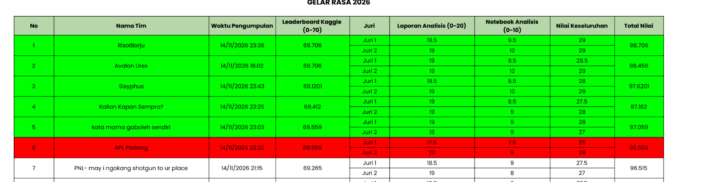

# Klasifikasi Citra Sampah | Gelar Rasa 2026 | Tim PNL - may i NSTUP?

Solusi tim PNL untuk babak penyisihan Data Science Competition Gelar Rasa 2026. Proyek ini mengklasifikasikan gambar sampah ke dalam delapan kategori. Karena data latih tidak menyediakan label kelas, tim menggunakan klaster visual dan peninjauan manual untuk membentuk *pseudo-label*.

## Hasil kompetisi

Tim PNL menempati **peringkat 7** pada rekap penilaian Gelar Rasa 2026.

| Komponen penilaian | Skor |
| --- | ---: |
| Leaderboard Kaggle (skor berbobot) | 69,265 / 70 |
| Laporan analisis (rata-rata dua juri) | 18,75 / 20 |
| Notebook analisis (rata-rata dua juri) | 8,50 / 10 |
| **Total** | **96,515 / 100** |

## Dataset

Dataset kompetisi berisi **1.920 gambar latih** dan **480 gambar uji**. Kategori targetnya adalah kaca (*glass*), kertas (*paper*), elektronik (*electronic*), logam (*metal*), plastik (*plastic*), kardus (*cardboard*), tekstil (*textile*), dan sisa makanan (*food waste*).

## Alur pemodelan

1. **Audit dan praproses citra.** Periksa integritas dan duplikasi gambar, konversi ke RGB, lalu terapkan *resize* dan *center crop*.
2. **Ekstraksi fitur visual.** Gabungkan embedding DINOv2 (1.024 fitur) dan ConvNeXt (1.536 fitur) menjadi 2.560 fitur per gambar.
3. **Pembuatan pseudo-label.** Kelompokkan embedding dengan K-Means menjadi 64 klaster, lalu tetapkan satu kategori per klaster melalui peninjauan visual. Langkah ini mengasumsikan kategori dominan mewakili anggota klaster.
4. **Klasifikasi.** Latih Logistic Regression dengan `class_weight="balanced"` dan gunakan K-Nearest Neighbors (KNN) sebagai pembanding.
5. **Penyempurnaan prediksi.** Jalankan dua iterasi *self-training* menggunakan prediksi gambar uji dengan *confidence* minimal 0,95 dan kesepakatan dari tiga *seed*. Terapkan *KNN smoothing* sebelum menghasilkan satu label per gambar uji untuk submission Kaggle.

## Validasi

Tim menggunakan **Stratified Group K-Fold** dengan 5 fold dan 3 *seed* (0, 1, dan 2). Gambar identik atau sangat mirip dikelompokkan berdasarkan hash piksel dan *cosine similarity* fitur DINOv2 dengan ambang 0,95. Anggota setiap grup ditempatkan di fold yang sama untuk mengurangi kebocoran antar-fold. Audit juga menemukan tiga pasangan gambar duplikat antara data latih dan data uji.

| Metrik internal | Baseline Logistic Regression | Model akhir |
| --- | ---: | ---: |
| Kesepakatan terhadap pseudo-label (*out-of-fold*) | 0,9714 | 0,9712 |
| Kesepakatan prediksi antarvarian | 0,9875 | 0,9986 |
| Konsistensi prediksi gambar duplikat | 1,0000 | 1,0000 |

Pada baseline, KNN memperoleh kesepakatan *out-of-fold* sebesar **0,9641**. Metrik internal mengukur kesesuaian terhadap pseudo-label dan stabilitas prediksi. Karena *self-training* memanfaatkan gambar uji, evaluasi generalisasi ke gambar baru memerlukan set uji berlabel yang independen.

## Tim

**PNL- may i ngokang shotgun to ur place** · UPN “Veteran” Jawa Timur

- Dani Shofi Nur Izza
- Haidar Adlan Rozaq Al B
- Nino Ahmadiy
